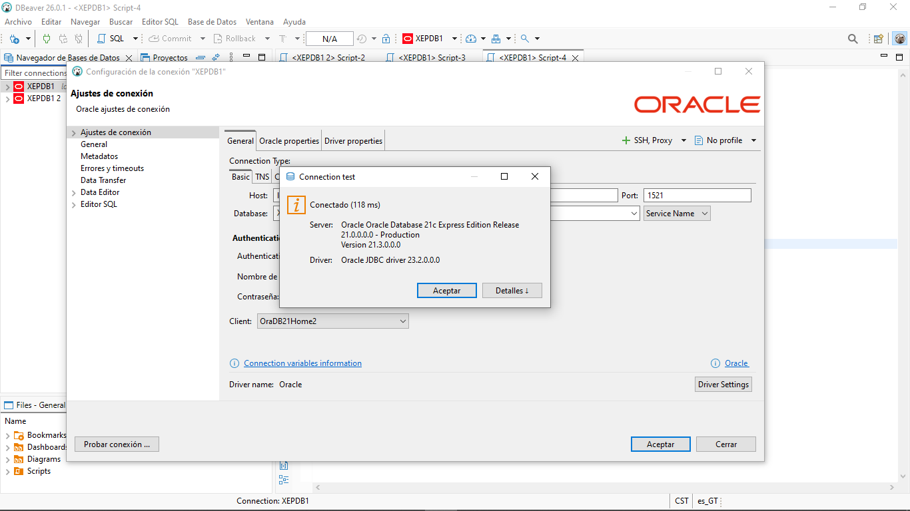
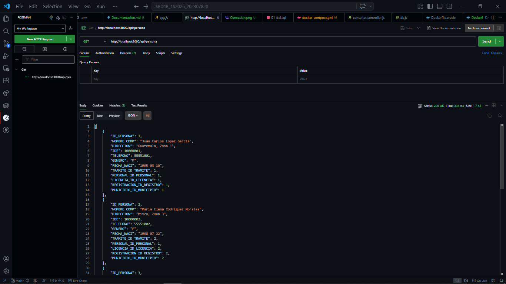
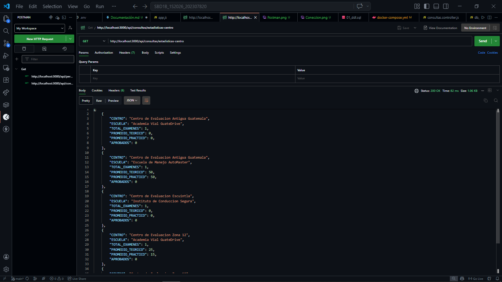
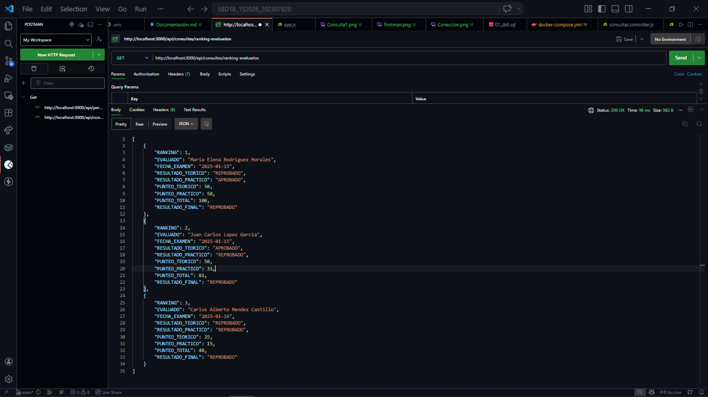
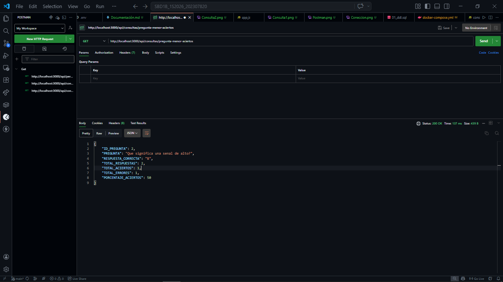
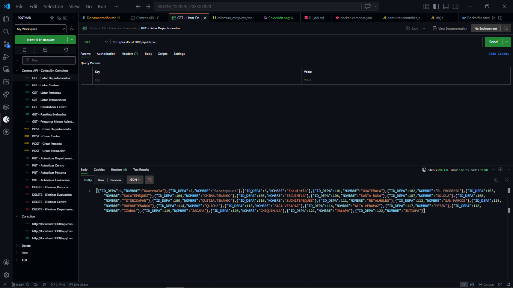
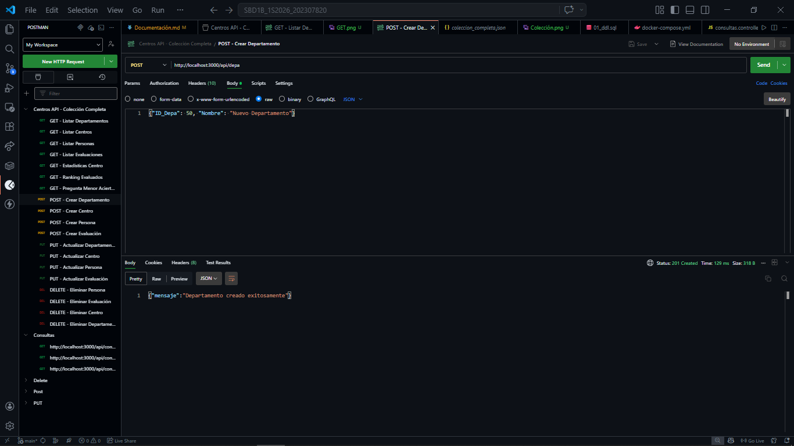
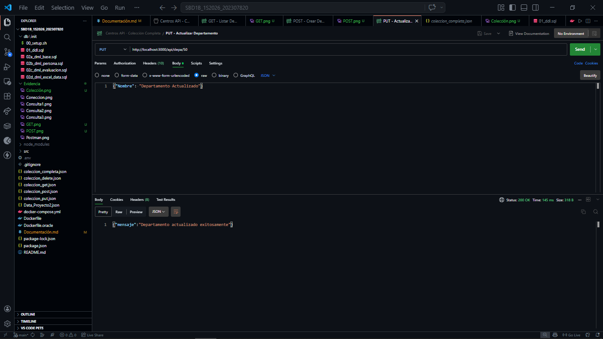
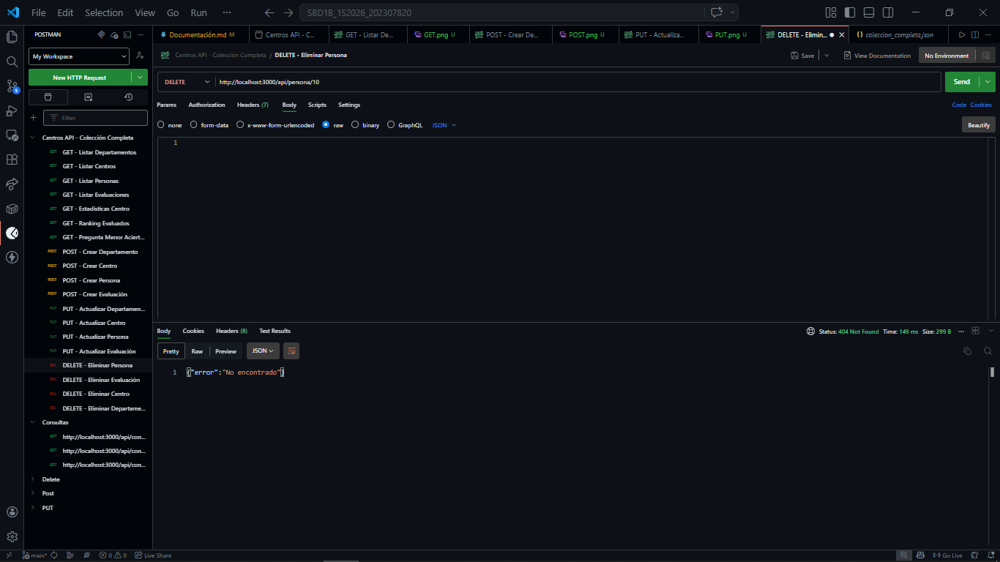
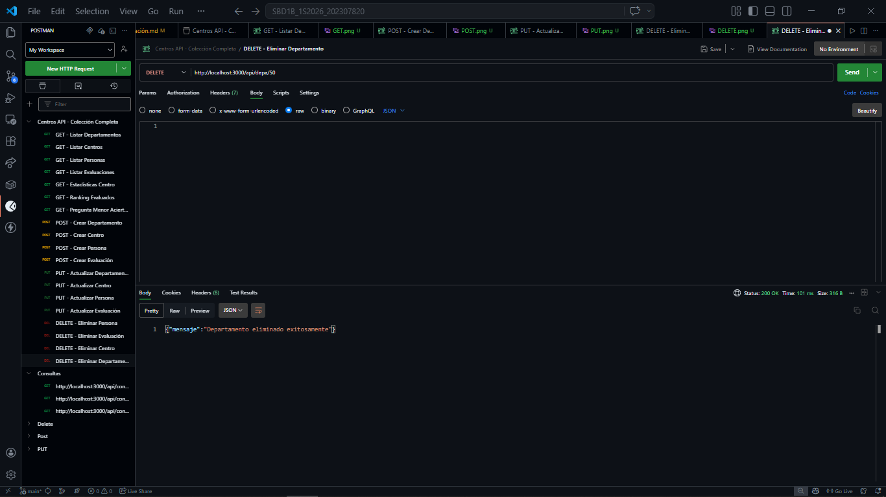

UNIVERSIDAD DE SAN CARLOS DE GUATEMALA

FACULTAD DE INGENIERIA

REDES DE COMPUTADORAS

CATEDRÁTICO: ING. ESPINO

============================================================================================

  
  

    <h1 style="color: White; text-decoration: underline; text-decoration-color: black;" >MANUAL TÉCNICO Backend y Exposición de Servicios para la Base de Datos “Centros de Evaluación de Manejo”"</h1>
  

============================================================================================

OTTONIEL FABRICIO VÁSQUEZ PINEDA
 
CARNÉ: 202307820
 
SECCIÓN A

GUATEMALA 30 DE Abril DEL 2026

## Requerimientos Técnicos

Para el funcionamiento de este sistema se utilizaron las siguientes tecnologías:

- Motor de Base de Datos: Oracle Database XE.
- Infraestructura: Docker y Docker Compose.
- Backend: Node.js con el framework Express
- Administración de BD: DBeaver
- Pruebas: Postman.

## Guía de Despliegue (Paso a Paso)

### Paso 1: Clonar el repositorio

Asegúrate de tener acceso al repositorio privado SBD1B_1S2026_202307820.

### Paso 2: Configuración de Variables de Entorno

Crea un archivo .env en la raíz del proyecto para parametrizar las credenciales de conexión (Usuario, Password, Host y Puerto).

### Paso 3: Levantamiento de Contenedores

Ejecuta el siguiente comando en la terminal para orquestar los servicios:

~~~
docker-compose up -d
~~~

Nota: El sistema está configurado para inicializar el esquema DDL automáticamente al levantar el contenedor de Oracle.

### Paso 4: Verificación de Persistencia

Los volúmenes de Docker han sido configurados para asegurar que los datos no se pierdan al reiniciar los contenedores.

## Conexión a DBeaver

Para auditar y verificar la estructura de la base de datos, sigue estos parámetros:

* Host: localhost
* Puerto: 1521 (o el configurado en tu .env)
* SID/Service Name: XEPDB1
* Usuario/Password: Admin1234

 

## Documentación de la API

### Operaciones CRUD
La API expone endpoints para realizar operaciones de Crear, Leer, Actualizar y Borrar en todas las tablas del modelo

* GET /api/[tabla] - Obtener todos los registros.
* POST /api/[tabla] - Crear un nuevo registro.
* PUT /api/[tabla]/:id - Actualizar un registro existente.
* DELETE /api/[tabla]/:id - Eliminar un registro.

 

### Consultas Estadísticas

1. Estadísticas por Centro y Escuela: Muestra el total de exámenes, promedios de punteo teórico/práctico y cantidad de aprobados

    * GET /api/consultas/estadisticas-centros

 

2. Ranking de Evaluados: Listado ordenado de aspirantes según su resultado final.

 

3. Análisis de Dificultad de Preguntas: Identifica la pregunta con menor porcentaje de aciertos.

 

## Ejemplo de Colecciones

### Ejemplo de GET

 

### Ejemplo de POST

 

### Ejemplo de PUT

 

### Ejemplo de Delete

 

### Ejemplo de ERROR

 

